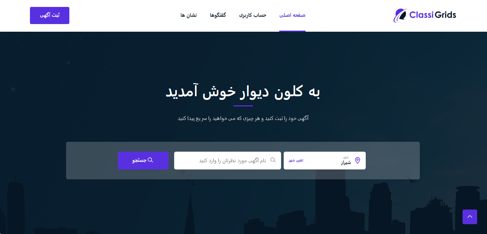
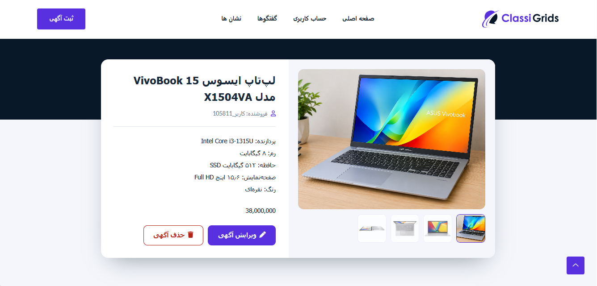
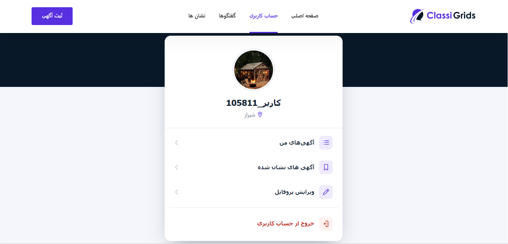
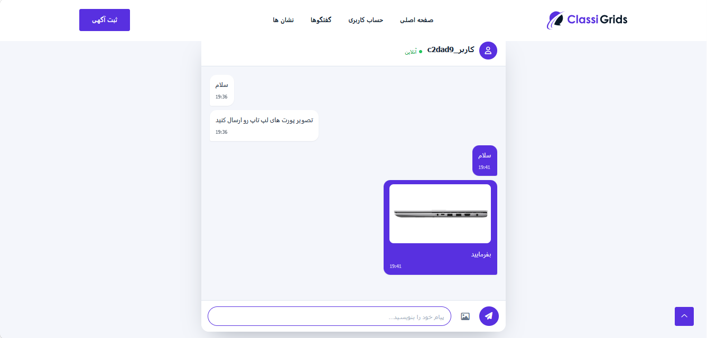

# Divar Clone

A classifieds marketplace built with **Python and Django**, inspired by [Divar](https://divar.ir), a popular Iranian classifieds platform.

Divar Clone allows users to publish listings, browse advertisements by category and location, manage their profiles, save favorite listings, and communicate through real-time chat. The application also includes OTP-based phone verification, real-time notifications, and online/offline user presence tracking.

## ✨ Features

- **Phone Authentication:** Verify phone numbers using one-time passwords (OTPs).
- **Listing Management:** Create, update, and manage listings.
- **Image Management:** Upload and manage multiple images for listings.
- **Search & Filtering:** Browse and filter listings by category, province, and city.
- **Location Management:** Select provinces and cities to find relevant listings.
- **User Profiles:** Update profile information, select a city, and upload profile pictures.
- **Bookmarks:** Save listings for later.
- **Real-Time Chat:** Exchange messages using Django Channels and WebSockets.
- **Chat Image Sharing:** Send images during conversations.
- **Real-Time Notifications:** Receive notifications about incoming messages.
- **User Presence:** Track users' online and offline status through WebSocket connections.
- **Access Control:** Restrict access to views and features that require authentication.
- **Custom Error Pages:** Custom 404 and 500 error pages. Set `DEBUG = False` in `settings.py` to view them.

## 🖼️ Screenshots

### Home Page



### Listing Details



### User Profile



### Real-Time Chat



## 🛠️ Tech Stack

| Technology | Purpose |
|---|---|
| Python | Programming language |
| Django | Backend framework and application logic |
| SQLite | Default database |
| Django Channels | WebSocket support and real-time communication |
| WebSockets | Bidirectional real-time communication |
| Redis | OTP management, channel layer, and connection tracking |
| HTML & CSS | Frontend structure and styling |
| JavaScript | Client-side interactions and WebSocket handling |
| Bootstrap | UI components and responsive styling |
| AJAX | Asynchronous HTTP requests |

## Redis Usage

Redis supports several components of the application:

- **OTP Management:** Store verification codes and manage their expiration.
- **Channel Layer:** Support real-time communication between Django Channels consumers.
- **Connection Tracking:** Support user connection tracking and online/offline presence management.

Redis must be running and accessible for the features that depend on it.

## 🚀 Getting Started

Follow these steps to run the project locally.

### Prerequisites

Make sure the following are installed:

- Python
- Git
- Redis

### 1. Clone the Repository

```bash
git clone https://github.com/byYasS/divar_simple_clone.git
cd divar_simple_clone
```

### 2. Create and Activate a Virtual Environment

```bash
python -m venv venv
```

On Windows PowerShell:

```powershell
.\venv\Scripts\Activate.ps1
```

### 3. Install Dependencies

```bash
pip install -r requirements.txt
```

### 4. Start Redis

Install Redis using a suitable method for your operating system and make sure the Redis server is running.

Verify that the Redis connection settings in Django match your local configuration.

### 5. Apply Database Migrations

```bash
python manage.py migrate
```

### 6. Run the Development Server

```bash
python manage.py runserver
```

Open the application in your browser:

[http://127.0.0.1:8000/](http://127.0.0.1:8000/)

## 🗄️ Database Configuration

The project uses **SQLite by default**.

You can configure the project to use another database supported by the installed Django version by installing the appropriate database driver and updating the `DATABASES` setting in `settings.py`.

Changing the database configuration does not automatically transfer existing data. Existing records must be migrated separately if they need to be preserved.

## Authentication Notes

Phone authentication uses one-time passwords (OTPs) to verify phone numbers.

**OTP delivery is simulated** for development and testing. The application does not currently send real SMS messages.

## 📁 Project Structure

The project follows Django's app-based architecture, with dedicated applications for different areas of functionality.

- `accounts/` — Phone authentication, OTP verification, and user profile management.
- `listings/` — Listings, categories, image management, search, and bookmarks.
- `locations/` — Province and city management and location selection.
- `chat/` — Real-time messaging, chat image sharing, notifications, and chat-related functionality.

Additional project-level modules handle configuration, routing, middleware, and other shared functionality.

## 👩‍💻 Author

**Yas S**

- GitHub: [@byYasS](https://github.com/byYasS)
